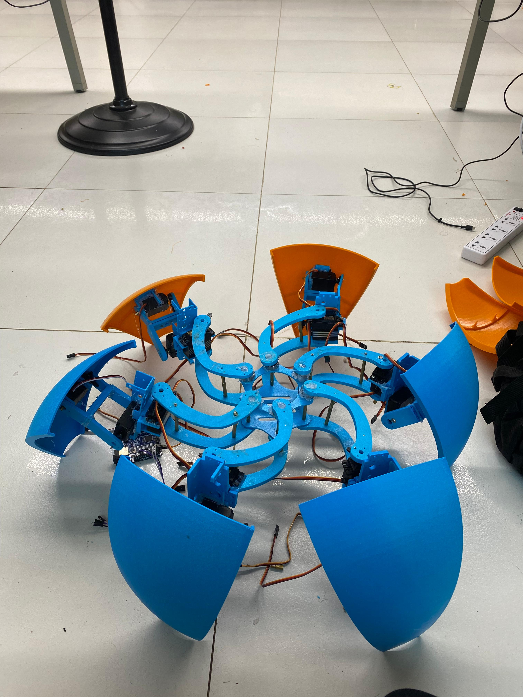
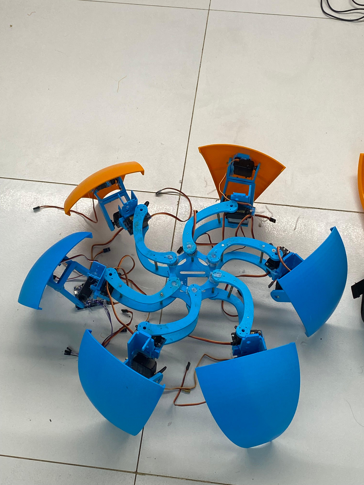
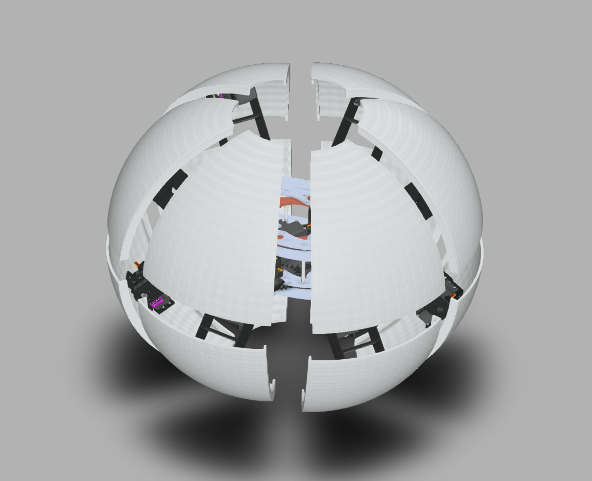

# Morphex — Multi-Modal Transforming Hexapod Robot

[](https://docs.ros.org/en/humble/)
[](https://isocpp.org/)
[](https://www.autodesk.com/products/fusion-360)
[](https://www.kicad.org/)
[](https://www.st.com/)

A **multi-modal hexapod robot** capable of **seamless transformation** between a stable **six-legged walking configuration** and a highly mobile **rolling spherical form**. Designed for heterogeneous terrain: walking for rough/cluttered environments, rolling for flat high-speed transit.

---

## 🎯 Why This Project

Most legged robots *or* spherical robots excel in one domain. Morphex demonstrates **mechanical + software co-design** for true multi-modal locomotion:

| Mode | Terrain | Speed | Stability | Energy |
|------|---------|-------|-----------|--------|
| **Hexapod (Walking)** | Rough, uneven, cluttered, stairs | Low | High (static stability) | High |
| **Sphere (Rolling)** | Flat, smooth, inclined | High | Dynamic (gyro-stabilized) | Low |

**Transformation** is a **single-degree-of-freedom** mechanism — all six legs retract/extend synchronously via a central cam-drive, completing in ~3 seconds.

---

## ⚡ Key Features

### 1. Mechanical Design (Fusion 360)
- **Central transformation mechanism** — cam-driven leg retraction/extension; single actuator morphs all 6 legs
- **Leg design** — 3-DOF per leg (coxa, femur, tibia) with series-elastic elements for compliance
- **Spherical shell** — 12 interlocking segments forming a dodecahedral rolling cage; structural in both modes
- **Modular CAD** — parametric Fusion 360 files; all parts 3D-printable (PETG/Carbon-fiber nylon)
- **Weight budget** — ~2.8 kg total (incl. battery, compute, actuators)

### 2. Control System (ROS 2 Humble + C++)
| Layer | Technology | Responsibility |
|-------|------------|----------------|
| **High-Level Planner** | ROS 2 (C++) | Gait sequencing, mode transition logic, terrain classification, global waypoint following |
| **Leg Controller** | ROS 2 (C++) | Inverse kinematics (analytical), trajectory interpolation, impedance control |
| **Transform Manager** | ROS 2 (C++) | Cam actuator trajectory, mode-state machine, safety interlocks |
| **IMU Fusion** | ROS 2 (C++) | Madgwick filter for roll/pitch/yaw (rolling mode stabilization) |
| **Low-Level MCU** | STM32 (C) | 18× PWM servo drive (3 per leg), current sensing, watchdog, safety E-stop |

**Gaits implemented:**
- **Tripod gait** (fast, statically stable) — default walking
- **Wave gait** (slow, maximum stability) — rough terrain
- **Rolling mode** — PID-stabilized sphere orientation via internal reaction mass

### 3. Custom Electronics (KiCad)
- **Main PCB** — 4-layer, STM32H7 + CAN-FD bus for 18 servo channels, 5V/12V/3.3V rails, battery management (2S LiPo), IMU (ICM-20948), E-stop latch
- **Power distribution** — 60 A continuous, peak 120 A during transformation
- **Connector strategy** — JST-GH for servos, Molex Micro-Fit for power, USB-C for debug

---

## 🏗️ Repository Structure

```
Morphex/
├── CAD-Morphex/                    # Fusion 360 parametric design
│   ├── Morphex-Arm/                # Leg linkage assemblies
│   ├── Morphex-Frame/              # Chassis + cam mechanism
│   ├── Morphex-Leg/                # 3-DOF leg subassembly
│   ├── morphex_v2.step             # Full assembly STEP export
│   └── temp/                       # Iteration exports
├── images/                         # Build photos & renders
│   ├── morphex-image.png           # Hero render
│   ├── morphex-1.jpg               # Walking mode photo
│   └── morphex-2.jpg               # Rolling mode photo
├── firmware/                       # STM32CubeIDE project (planned)
│   └── README.md
├── ros2_ws/                        # ROS 2 workspace (planned)
│   ├── src/
│   │   ├── morphex_control/        # High-level planner + leg controller
│   │   ├── morphex_transform/      # Transformation state machine
│   │   ├── morphex_bringup/        # Launch files, params, URDF
│   │   └── morphex_description/    # URDF + meshes for RViz/Gazebo
│   └── README.md
├── hardware/
│   ├── kicad/                      # Main PCB project (planned)
│   └── BOM.csv                     # Bill of materials (planned)
└── README.md
```

> **Note:** `firmware/`, `ros2_ws/`, and `hardware/kicad/` are **planned directories** — code is in active development. Current repo contains mechanical CAD + documentation.

---

## 🚀 Build & Assembly

### Mechanical (Current)
1. **3D Print** all parts from `CAD-Morphex/` (PETG recommended; carbon-fiber nylon for high-stress legs)
2. **Hardware** — M3/M4 fasteners, 18× SM-S4303R servos (or equivalent 20 kg-cm), 1× high-torque cam actuator (Dynamixel XL430 or custom BLDC + gearbox)
3. **Assemble** per exploded views in Fusion 360; cam timing critical — verify leg sync before first power-on

### Electronics (Planned)
```bash
# PCB fabrication
# 1. Open hardware/kicad/morphex_main.kicad_pro in KiCad 8+
# 2. Generate Gerbers → send to JLCPCB / PCBWay (4-layer, 1 oz Cu, ENIG)
# 3. Assemble: STM32H743, TJA1051T CAN transceiver, ICM-20948, MP2307 buck converters, JST-GH/Molex connectors
```

### Software (Planned)
```bash
# ROS 2 workspace
cd ros2_ws
colcon build --symlink-install
source install/setup.bash

# Launch simulation
ros2 launch morphex_bringup simulation.launch.py

# Launch on robot
ros2 launch morphex_bringup robot.launch.py
```

---

## 📸 Media

| Walking Mode | Rolling Mode | Transformation Sequence |
|--------------|--------------|------------------------|
|  |  |  |

---

## 📐 Design Decisions (For Interview Discussion)

| Decision | Rationale |
|----------|-----------|
| **Single-DOF transformation (cam)** | Minimizes actuator count/weight; deterministic timing; no coordination needed across legs |
| **Dodecahedral shell (12 segments)** | Approximates sphere for rolling; each segment is a structural leg fairing in walking mode — zero dead weight |
| **Series-elastic leg elements** | Protects servos from shock loads; enables force control; stores/releases energy in gait |
| **CAN-FD bus for servos** | Deterministic low-latency (1 Mbps), daisy-chain wiring, built-in error detection — superior to PWM for 18 channels |
| **ROS 2 on SBC + STM32 for IO** | Separation of concerns: Linux for planning/perception, bare-metal for hard real-time servo loops |
| **Analytical IK (not numerical)** | 3-DOF leg has closed-form solution; 100× faster, no convergence failures, deterministic latency |

---

## 🗺️ Roadmap

- [ ] Complete STM32 firmware (CAN-FD servo driver, current monitoring, E-stop)
- [ ] ROS 2 packages: `morphex_control`, `morphex_transform`, `morphex_bringup`
- [ ] URDF + Gazebo simulation with rolling physics
- [ ] PCB v1.0 fabrication & bring-up
- [ ] Outdoor terrain testing (grass, gravel, stairs)
- [ ] SLAM integration (LiDAR) for autonomous navigation in both modes

---

## 📝 License

MIT License for software. Hardware (CAD, PCB) licensed under **CERN-OHL-P v2** — see [LICENSE](LICENSE) for details.

---

## 🙏 Acknowledgments

- Inspired by **MorpHex** (Kåre Halvorsen) and **Rotundus GroundBot** — this is an original derivative design.
- Fusion 360, KiCad, ROS 2, STM32CubeIDE — open ecosystems that make this possible.